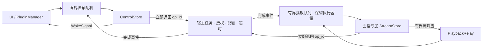

# Iris 插件系统 v2 架构规范与演进路线图（protocol: 2）

> **状态：源码已完成协议 2 切换；跨平台发布和性能验收仍有待验证项；修订日期：2026-11-24。**
> 决策依据见 [PLUGIN_V2_DECISIONS.md](PLUGIN_V2_DECISIONS.md)。当前源码为 `0.0.1 / protocol: 2`，未发布新版本；[PLUGINS.md](PLUGINS.md)、[ARCHITECTURE.md](ARCHITECTURE.md) 记录现状。[PLUGIN_V2_IMPLEMENTATION.md](PLUGIN_V2_IMPLEMENTATION.md) 记录分阶段实现与实际验收证据。
> 下文“必须”“禁止”是实现要求；配额是首版策略基线，性能项目是待测目标，均不表示已通过验收。

## 1. 目标、分层与信任模型

- `iris-core` 保持无头：负责插件、会话、网络、流源、数据与任务；原生窗口、交换链和 UI 集成留在 `iris`，FFI 留在 `iris-mpv`。
- `iris-api` 常规依赖仅 `serde`；新 `iris-plugin-sdk` 封装 Guest ABI 与异步状态机，可编译到 `wasm32-unknown-unknown`。SDK 不向 Guest 暴露宿主任意文件、进程或网络权限。
- Wasmtime 使用同步调用接口，按实际锁定版本显式选择编译/runtime 特性；宿主 I/O 协议异步化，不直接引入 `tokio`。同步 Wasmtime 不等于同步等待网络。
- 新依赖按实际特性和传递依赖通过 `deny.toml`；生产模块维持 650 行软限 / 850 行硬限等现有门禁。没有基于选库名称的自动许可合规结论。

| 对象 | 信任与责任 |
|---|---|
| 第三方/官方 Guest、包内容、网络响应、清单、媒体字节 | 均验证；官方身份不绕过能力与配额检查。 |
| 宿主、Wasmtime、解复用/解码库 | 可信实现边界；仍需版本审查、故障测试和边界 fuzz。 |
| 用户显式绑定的原生工具与批准的辅助程序 | 可信本地程序。语义适配器约束插件请求；不宣称进程自动获得 OS 沙箱。 |
| 用户授权记录 | 仅由宿主可信交互生成、扩展或撤销；插件声明和表单默认值不等于授权。 |

所有敏感操作同时检查插件身份、实例角色、已授予能力、作用域、代次和配额。没有 `read_state` 不发送完整播放快照；其他能力所需的最小媒体 ID、时间窗口、标记或文件内容也须逐项授权，不能把 `read_state` 当成唯一隐私开关。

## 2. 包、身份与内存编译

### 2.1 包格式与安装

```text
<plugin-id>.irisplugin       # ZIP (Stored/Deflate)；开发态可为同名目录
├── plugin.json             # protocol、abi、能力声明、网络范围、贡献项
├── plugin.wasm             # 可选；纯声明式主题可省略 entry
└── assets/                 # 声明的静态资源
```

- 官方归档与摘要索引由 `Resources/Plugins/` 嵌入宿主；产品首次启动在后台安装至应用数据目录 `plugins-v2/`（开发覆盖 `IRIS_PLUGINS_V2`）。开发目录只供校验 API 使用，不自动执行任意可写目录内容。
- 设置中的安装选择器先校验不可变包快照，再审核授权和原子安装；失败保留旧版本。禁止运行包内原生可执行文件。
- 安装审核保留已读取的不可变包内容，后台完成格式及 Wasm 编译校验；批准前不实例化或执行 start/init。审核有效期 5 分钟，协调器最多保留两份；批准绑定所展示的摘要、权限及旧安装记录，在安装锁内再次比对旧记录。期间换文件或另一窗口完成更新都不能偷换审核对象。ZIP 中央目录最多 4 MiB，先验证记录数量、偏移及范围，再交给 ZIP 库解析。
- 校验 ZIP 条目数、压缩及展开总量；拒绝绝对路径、盘符/UNC、`..`、反斜杠歧义、NUL、符号链接/reparse 越界、重复路径和大小写折叠冲突。开发目录也验证最终路径归属，不把 ZIP 路径规则当作目录安全替代品。
- 清单含 `protocol: 2`、`abi: 2`、`entry`、能力与网络范围声明；未知协议、必需能力、导入或不支持的 Wasm 特性拒绝加载。可选贡献项允许明确的能力发现与降级，不静默授予权限。
- 首版上限：包 32 MiB、展开 64 MiB、1,024 项、单 Wasm 16 MiB、单清单 64 KiB。所有额度在读入/展开前及过程中核算。

### 2.2 身份、升级与凭据

- 官方 `iris.*` 只接受随主程序发布的可信包索引所绑定的 ID 与内容摘要；不能仅凭目录名认定官方。首版用户目录拒绝 `iris.*`，独立签名插件索引与更新机制列入远期工作。
- 同 ID 多包冲突拒绝加载，不按扫描顺序覆盖。替换包必须经安装器；增加能力重新授权，撤销授权使相关在途操作失效。
- 第三方包自报 ID 不证明作者身份；替换、重装不得静默继承另一安装身份的授权与凭据。宿主记录安装身份及已确认的内容更新。
- 凭据按宿主确认的插件安装身份隔离。只对可信官方 WebDAV 执行 `builtin.iris.webdav` 的定向迁移，不开放任意旧作用域查询。
- v2 Init 不携带整份状态或凭据。`StateRead/StateWrite { key, value? }` 与 `SecretRead/SecretWrite { bucket, key, value? }` 均使用后台任务及 Completed 终态；取代旧协议的 SetState/SetSecret 返回命令。插件私有状态不要求 read_state；秘密需 secrets 或 media_source，StreamStore 均禁止这些任务。
- 状态文件按安装身份绑定、锁内读取最新版本并原子写入，128 个键、单值 32 KiB、整个序列化记录 256 KiB；读出值还必须能装入控制消息。秘密只进入系统凭据库，Plugin 桶与宿主确认的规范 Origin 桶分离，合计最多 64 个键、单值 2 KiB。不通过 Guest 提交的任意字符串选择旧安装或其他插件作用域。
- 同一安装身份同时仅接收一个状态/凭据作业，其他请求返回 BACKPRESSURE。锁冲突、损坏文件和系统 vault 错误不能解释为空数据并覆盖。写入提交与取消竞争时可能已落盘；取消不撤销已完成写入，重试前读取当前值/状态 revision。停止后的在途作业继续持有配额至退出。

### 2.3 不使用磁盘机器码缓存

在后台使用安全编译 API 校验并编译 Wasm；`Module` 仅在有界内存缓存中复用，身份键包括内容摘要与当前 Engine 配置。禁止接受包中预编译机器码，禁止 `Module::deserialize*`、可信预编译文件入口及磁盘 AOT 缓存。

限制编译并发、排队和输入规模；Epoch 不负责中断编译器。运行中的 Module 通过引用保持有效，闲置项可淘汰。编译/实例化耗时、产物及瞬时编译内存需测量，不承诺固定毫秒或微秒值。macOS JIT 权限、签名公证和平台支持以构建测试为准。

## 3. 实例、调度与生命周期

### 3.1 控制和播放实例



- 每插件一个 `ControlStore`；RandomAccess/VirtualManifest 每播放会话一个 `StreamStore`，同一 Module 独立实例化，不共享 Guest 内存。DirectHttp 不为每块数据创建 Guest 调用。
- 一个安装身份的 ControlStore 同时服务多个窗口：宿主用 `Window { window, generation, body }` 包裹窗口事件和异步完成，回复继承当前窗口。每插件最多四个活跃窗口上下文，宿主分配 ID 且不复用；Init/安装状态为全局，StreamStore 事件保持会话专属。窗口之间仍共享同一 Guest 内存，不是不同插件的安全边界。
- 每个窗口有独立取消域和宿主服务句柄。控制事件的外层 `Window.generation` 绑定媒体/context 生命周期；普通拖动或 mpv 原生 A-B 循环只推进 StreamSession 的读取代次和 TimedOverlay 的内层 seek 代次，不撤销同窗口的目录、配置保存或登录任务。切集、关闭、停用才撤销对应控制窗口上下文。切换回调时隔离 Blob 句柄表，禁止在另一个窗口回调中读取或关闭原窗口的句柄。后台结果须经过各自作用域的代次检查才能应用。关闭后的服务仍保留其资源账本直到 I/O 退出；每插件最多八个活跃或等待回收的窗口执行器，超过返回背压。
- 单 Store 任一时刻仅执行一个 Guest 调用。网络、工具、全量文件哈希在两种实例中都必须返回后再等待完成事件；中继的等待不能占着 Store 或 UI 线程。
- 播放/控制分离队列与执行容量，限制单插件连续占用；同时等待视频、音频、清单、Range 的请求以 ID 区分。排队、执行、I/O、结果缓冲均有独立账本。
- 设置内存/表/实例限制、Epoch 和调用预算后才允许实例化及执行 start/init。未启用实例不执行 Guest 代码。
- Epoch 定时器只在 Guest 可能执行时需要活跃；建议 10ms 粒度，普通调用初始硬截止 2s、初始化 5s，均为墙钟保护值，非精确 CPU 计量或正常延迟目标。宿主短计算另有输入规模限制，长任务使用独立超时与取消。
- 有需要时增加 Fuel 执行量预算；具体额度须按固定夹具标定。禁止以 Epoch/Fuel 替代阻塞宿主调用的截止时间。

### 3.2 请求、代次与流上下文

公共身份键为 `(installation_id, plugin_epoch, instance_id)`；敏感请求另绑定 `session_id / media_generation / seek_generation` 及网络授权版本。宿主分配 ID，Guest 不得指定别人的命名空间。

- 媒体切换递增 media_generation；拖动递增 seek_generation 并取消被替代的流请求。晚到结果只回收资源，不应用于新媒体。
- `StreamInit` 传递只读初始上下文与必要能力引用；`StreamContextUpdate { version, ... }` 支持签名 URL、密钥轮换和鉴权刷新，拒绝回退版本。已在途请求保持绑定其版本；涉及撤权则立即取消，不能等版本自然过期。
- StreamStore 仅导入所需网络、密码学、时钟、随机数和流响应接口；不导入 UI、工具、导出、任意凭据枚举或本地文件能力。
- 控制实例普通 Trap 进入 `ControlError`，取消其任务；现有流仅在授权和上下文仍有效时可继续。更新依赖失败需显式返回错误。权限违规/ABI 损坏可隔离整个插件，用户停用/卸载则必须终止全部子资源。
- 播放准备请求的取消范围在准备完成时结束；准入后的中继继续绑定安装身份、窗口和媒体生命周期。拖动推进 seek 并取消旧读取，不直接关闭整个中继；切集、窗口关闭和停用撤销整路播放。控制实例失败后不接收新的播放准入，普通超时不自动撤销已获准的独立流。
- SDK 内部凭据副本仅在必要上下文中出现；日志、错误文本、调试快照和进度事件不得包含密钥、Cookie 或签名 URL 查询串。

### 3.3 状态机与取消

插件：`Discovered → Validated → AwaitingGrant → Compiling → Initializing → Ready → Stopping → Disabled/Unloaded`；任何阶段失败进入带原因的 Error，不自动循环重启。

会话：`Opening → Ready → Closing → Closed`，失败也经 Closing 回收。状态转换必须幂等：

1. 标记 Closing/Stopping，撤销新请求能力，递增代次并关闭入队入口。
2. 取消会话/实例的子 HttpCancel、任务、工具与待交付响应，触发 Guest 中断。
3. 后台等待执行中的调用退出、I/O 结束、工具终止；UI 只观察状态，不 join 等待。
4. 由持有实例的执行侧释放 Store、缓冲、句柄、私有临时文件和授权引用；清理失败记录可重试任务。

`HttpCancel` 只能负责接入它的宿主操作；DNS、进程、文件作业和回调队列也必须定义独立取消与清理路径。不能跨线程销毁正在调用的 Store，也不承诺释放后进程 RSS 瞬间归零。

## 4. ABI v2：控制编码、字节与所有权

### 4.1 模块与控制面

- Core Wasm32，导出一个非共享 `memory`；首版不接受 memory64、多内存、共享内存、Guest 线程或 WASI。导入命名空间固定为 `iris_v2`，按实例角色建立能力白名单。
- 控制面为 UTF-8 JSON，使用 `iris-api` 的带标签枚举、snake_case 标签；只使用有明确 schema 的字段。重复键、非有限浮点、超深结构、未知必需变体拒绝。JSON 深度上限 32，单消息 64 KiB，单返回批次最多 64 个命令。
- JSON 中所有 u64/i64 数值使用规范十进制字符串（无加号、无多余前导零），避免其他语言精度损失；FFI 数值仍是 Wasm 整数。SDK 提供相同测试向量。
- ABI/协议首版均为 2；成功、错误消息的固定 JSON 包络分别为 `{"ok":[...]}`、`{"error":{"code":-1,"message":"..."}}`。错误文本限 1 KiB、脱敏；副作用前先验证该批消息。
- 媒体字节不塞入 JSON/Base64；使用缓冲句柄或当前调用内的指针长度。分块边界是内存边界，不是假定的容器/加密块边界。

### 4.2 Guest 导出

| 导出 | 精确语义 |
|---|---|
| `iris_abi_version() -> i32` | 必须返回 2；此调用也受预算约束。 |
| `iris_alloc(len: i32) -> i32` | 参数按 u32 解读；正长度分配返回非零 ptr，失败返回 0；len=0 返回 0。SDK 使用与 dealloc 匹配的布局。 |
| `iris_dealloc(ptr: i32, len: i32)` | 仅释放分配的同一 ptr/len；(0,0) 无操作。 |
| `iris_on_event(ptr: i32, len: i32) -> i64` | 输入为借用的 JSON；返回位模式 `(u64(ptr) << 32) \| u64(len)`；0 表示无返回命令。非零结果要求 ptr、len 都非零，且为完整 JSON 包络。 |

所有 i32 指针/长度按无符号位模式解释。宿主用 checked arithmetic 验证 ptr+len、消息上限及当前 memory.size，不能直接信任 Guest 指针。

宿主调用顺序：分配输入 → 取得短期可变借用并写入 → 释放借用 → 调用事件 → 验证输出范围与输入不重叠 → 复制输出到宿主自有缓冲 → 释放借用 → dealloc 输出及输入 → 验证并应用命令。Guest 不释放/长期保存输入指针；输出所有权移交宿主。任何 Guest 调用后必须重新取得 memory 视图。

指针异常、输出别名、无法完成的分配/释放或 Trap 使该实例失效；不得在损坏的实例上继续调用分配器“补救”。按取消流程释放整个实例。跨 Guest 调用、异步等待、线程切换保存 Memory 切片或裸指针均禁止。

### 4.3 Host 导入与异步操作

| 导入 | 结果与责任 |
|---|---|
| `host_submit(ptr: i32, len: i32) -> i64` | 读取、复制并验证任务 JSON；成功返回正 op_id，失败返回负错误码。只做有界校验/入队，不等待网络、磁盘、进程或用户。拒绝时不创建任务。 |
| `host_blob_new(ptr: i32, len: i32) -> i64` | 将最多 1 MiB 字节复制进宿主自有不可变 Blob；返回正句柄或负错误码，内存计入账本。 |
| `host_blob_len(handle: i64) -> i64` | 返回非负长度或负错误码。 |
| `host_blob_read(handle: i64, offset: i64, dst: i32, cap: i32) -> i64` | cap 必须在 1..=1 MiB；返回读取量，0 仅表示 offset==总长的 EOF，越界/取消返回负码。短读允许，调用方按返回量推进。 |
| `host_close(handle: i64) -> i32` | 关闭本实例资源；0 成功，过期或越权返回负码。内部级联清理幂等，不影响别人的资源。 |
| `host_stream_reply(request_id: i64, blob: i64, flags: i32) -> i64` | 仅 StreamStore；接受一次 read 请求的一个有界结果，成功返回字节数并消费 Blob；失败返回负码且不消费 Blob。flags 位 0 为 EOF，其余位必须为 0。 |
| `host_stream_fail(request_id: i64, code: i32) -> i32` | 以允许的负错误码结束本实例在途流请求；0 成功，否则返回负码。 |
| `host_crypto(spec_ptr: i32, spec_len: i32, in_ptr: i32, in_len: i32, out_ptr: i32, out_cap: i32) -> i64` | 第 7 节的有界同步纯计算；返回输出长度或负码，校验所有缓冲范围。 |
| `host_random(dst: i32, len: i32) -> i32` | 宿主 CSPRNG，最多 64 KiB，0 成功或负码；不提供确定性“安全随机”回退。 |
| `host_clock(kind: i32) -> i64` | kind=0 为 Unix 毫秒，1 为实例启动后的单调毫秒；不支持返回负码，不授予环境/文件访问。 |

op_id、handle、request_id 使用 1..=i64::MAX，宿主绑定身份和代次，运行期不循环复用；JSON 中按十进制字符串传递。不同 Store 不共享裸句柄，通过宿主显式转交新授权引用。

accepted op 最终产生一个终态事件：完成、失败或取消；成功的 HTTP 头事件可创建后续读取用 stream_handle。实例退出时未交付的终态事件转为宿主账本终态并释放，不要求再次唤醒已销毁 Guest。中间进度可合并，终态通知必须预留队列容量。

`HttpStart`、`HttpRead`、`HttpWrite`、Socket/WS、工具和文件哈希均使用 submit/完成事件。`HttpRead` 返回 `{blob, eof}`，零字节仅与 eof=true 同时出现；没有数据时保持异步等待，不以空包忙轮询。HTTP 状态码属于正常响应，不能与传输错误混淆。

同一 HTTP 响应流至多一个在途读任务；同一请求体的写入按提交顺序完成。TCP/WS 各方向分别保持顺序，可并行一个读和一个写，不以并发调用打乱协议字节；超额请求返回 BAD_STATE/BACKPRESSURE。关闭句柄取消其未完成操作，实际退出前仍占配额。

### 4.4 错误、流读取与生命周期

| 错误码 | 名称 | 语义 |
|---|---|---|
| -1 | INVALID_ARGUMENT | schema、缓冲、参数或数值无效 |
| -2 | DENIED | 缺少能力或作用域不允许 |
| -3 | QUOTA_EXCEEDED | 资源总量达到上限 |
| -4 | BACKPRESSURE | 有界队列/并发槽已满，未接受任务 |
| -5 | CANCELLED | 任务或所属会话取消 |
| -6 | TIMEOUT | 指定阶段截止时间到达 |
| -7 | STALE_HANDLE | 句柄、请求、上下文或媒体代次过期 |
| -8 | UNSUPPORTED | 不支持的协议/格式/语义/工具版本 |
| -9 | IO_ERROR | 网络、磁盘或进程 I/O 失败 |
| -10 | AUTH_FAILED | 鉴权失败或 AEAD 验证失败；不返回未认证明文 |
| -11 | RANGE_INVALID | 溢出、不可满足的范围或错误的响应范围 |
| -12 | BAD_STATE | 重复完成、角色不允许或状态次序不合法 |
| -13 | INTERNAL | 宿主内部失败，脱敏报告 |
| -14 | OUT_OF_WINDOW | 叠层不在已授予的时间窗口 |

0 不统一表示 EOF：它在 status 接口表示成功，在 blob_read 表示 EOF，在 stream_reply 中须结合 EOF 标记；异步待完成由正 op_id 表达，不占用负错误码。

宿主以 `StreamRead { request_id, session_id, media_generation, seek_generation, context_version, resource_id, offset, len }` 投递读取；len 为 1..=1 MiB。Guest 可先启动 I/O，在后续事件中 reply/fail，不保留同步 `iris_on_stream_read` 或直接返回原始清单的入口。

每个 request_id 至多完成一次。reply 字节不得超过 len；短读可不带 EOF，宿主推进 offset；零字节必须 EOF。已知 size 时不能提前报告 EOF，offset==size 才允许空 EOF，offset>size 报 RANGE_INVALID。宿主按 HTTP Range 语义生成 200/206/416、Content-Range/Length 和 HEAD；未知长度禁止伪造总长，suffix Range 仅在能确定长度时支持。

取消与完成竞争由宿主原子状态转换决定；失去竞争或代次过期的结果仅释放。协议畸形和越权均返回有界错误或使实例失效，不允许宿主 panic。跨异步边界允许必要字节复制，因此不承诺端到端零拷贝。

## 5. 网络、登录与凭据边界

### 5.1 能力与目的地

请求级 `NetworkGrant` 是协议能力与目的地范围的交集；Guest 的声明只是申请。宿主保存授权版本和确认来源。

| 项目 | 首版契约 |
|---|---|
| `net_http` / `net_ws` | 分别允许 HTTP(S) 与 WS(S)；不互相隐含。 |
| `net_tcp` | 原始 TCP/TLS，单独确认目标 host:port；不因 net_public 获得任意 TCP/端口。 |
| `net_hosts` | 公网域名匹配范围，声明 scheme 与端口集合。裸域精确匹配；`*.example.com` 仅匹配点分隔的子域，不匹配裸域或 `evil-example.com`。IDNA、大小写与尾点先规范化。 |
| `net_public` | 对获准 HTTP/WS 协议和端口允许公网目标；默认端口为 80/443，其他端口须额外声明确认。对安装/启用界面明确展示，不从命中 URL 自动升级。 |
| `PrivateOriginGrant` | 宿主确认的 scheme、host、port、解析后的私有 IP 集合及授权版本；不允许 CIDR 扫描或继承其他连接的授权。 |
| 宿主回环能力 | 播放中继、工具任务代理、OAuth 回调使用各自窄能力，不成为插件通用 localhost 许可。 |

自建服务的表单提交后由宿主显示真实规范化 Origin 与目的地并确认；UI 默认值、隐藏字段、插件回调或服务器重定向不能创建授权。地址集合变化、TLS 身份变化或新增 Origin 需要重新校验/授权；不能永久锁定旧 IP 后静默改连新地址。

自建服务使用公网地址时，宿主可生成同等精度的用户确认公网 Origin 授权，不要求插件升级为 net_public；它仍受协议/端口和跨 Origin 凭据规则约束。公网授权不会随 DNS 变化转为私网授权。

实现接口：`RequestOrigin { request_id, origin }` 需要 ui_modal 与 net_http，只请求宿主审核；Host 的 `OriginGranted` 返回单次审核结果。`OriginLookup` 是控制面异步任务，只返回当前安装身份已确认的 Origin 句柄，不在 StreamStore 中开放。审核最多两份（含尚未退出作业）、有效期 5 分钟，绑定窗口、媒体代次及授权版本；窗口关闭、换代或停用后拒绝批准。规范 Origin、解析 IP、旧固定地址及明文凭据选项由宿主独立展示，Guest 表单值不能代替确认。

宿主专属授权文件按安装身份保存最多 16 个 Origin；锁内比对审核时的旧条目并原子写入，损坏记录不能当作空记录覆盖。重新确认撤销同一 Origin 的旧句柄；启动时恢复已确认的固定地址，不自动跟随 DNS 改变。批准提交与取消竞争时可能已经持久化，界面需反映实际记录，不能把“取消等待”承诺为撤销既有批准。

### 5.2 全部出口统一执行

以下出口必须传递安装身份、实例/会话、授权版本及请求作用域：RawHttp、WS/TCP、DirectHttp 主备 URL、各音轨/字幕、缩略图、远程照片探测、清单与子资源、鉴权刷新及工具适配器的宿主请求。

1. 规范化并校验初始 URL、scheme、端口、域名；拒绝 userinfo、非法头和未授权协议。
2. 每次重定向重新校验，不接受 HTTPS 降级、超次数或循环；默认最多 10 跳。
3. DNS 结果逐地址分类，处理 IPv4-mapped IPv6 等规范化与特殊地址；连接的必须是通过检查的地址，不再由另一个路径重新解析。
4. 公网作用域拒绝私网、回环、链路本地、组播及不可路由/特殊用途目标；私网仅允许对应授权 Origin 和锁定集合。即使同插件另有 NAS 授权，公网请求也不得借用。
5. TLS 保留原域名的证书/SNI 验证，不把通过 IP 校验当作关闭证书验证的理由。
6. 每次读取、完成交付和新连接检查取消/代次；撤权、关闭会话和插件停用终止对应在途操作。

地址策略以宿主可验证的目标连接为边界，不能保证目标物理位置；本地设备也可能拥有全球单播地址。远端账户的读写权限由服务端凭据与接口决定：允许任意 RawHttp 方法不等于远端账号只读，宿主本地源文件保护不能被宣传为防止任意远端删除。

### 5.3 请求与凭据语义

- `HttpStart { method, url, headers: Vec<(String,String)>, body_handle?, stream_body, follow_redirects, timeout_ms, origin_grant? }` 异步返回响应状态、重复响应头和 stream_handle。`stream_body=true` 与 body_handle 互斥，先返回 `state=upload` 及句柄，再经 HttpWrite 供给；`finish=true` 结束宿主生成的 chunked 消息并返回 `state=response`。流式请求体不自动重放重定向，需重定向重试时返回 UNSUPPORTED。请求/响应头字符串以 U+0000..U+00FF 对应原始 HTTP 字节，仍拒绝危险控制字符；非此范围的请求头值拒绝。响应头同时受 HTTP 头 64 KiB 和序列化控制消息 64 KiB 上限约束，超限返回 QUOTA_EXCEEDED，不截断头。
- `follow_redirects=false` 返回当前 30x 的 Location/Set-Cookie；不会凭空包含尚未访问的“全部中间响应”。启用跟随后，逐跳 Cookie 按各自 Origin 管理，可提供有界脱敏诊断。
- 宿主生成 Host、Content-Length/Transfer-Encoding、连接及代理控制头；拒绝 CR/LF/NUL、冲突长度及不合法方法。不能利用“Raw”绕过 HTTP 消息边界和网络策略。
- 凭据绑定 Origin/资源；跨 Origin 默认移除 Authorization、Cookie、代理凭据及未明确许可转发的自定义头，独立轨道与 CDN 使用各自授权的头。新目的地许可不自动扩大凭据范围；Origin 授权不绕过已有的明文传输凭据确认规则。
- 解析/连接/握手默认截止 10s，响应头和读取空闲截止 30s；目录/元数据任务总体截止 60s，流请求每次截止 30s。插件可缩短，不能取消宿主上限；长直播以分块活动和会话取消维持。
- WS 支持有界 Text/Binary 消息及完成事件；帧和重组消息均至多 1 MiB，控制帧处理限 256 次/秒，连接升级不自动跟随重定向、不协商压缩扩展。TCP/TLS 提供异步 connect/read/write/close；长连接采用可唤醒事件循环，读写各一项，等待可读不能占住提交写入所需的工作线程。SDK 需适配协议库的 I/O、时间和随机数依赖，不能假定所有 Rust 协议库直接编译就能工作。

### 5.4 登录辅助

二维码、表单及 Cookie/Token 导入保持声明式；不自动读取用户浏览器凭据。OAuth 分两步：

1. `BeginAuth { callback_path, issuer? }` 创建限时事务，宿主绑定安装/实例/代次、随机 state、PKCE S256 材料、预期回调路径，并返回实际绑定的 IPv4 回环 redirect_uri（含端口）、state、challenge 和有效期；verifier 只在成功回调后交付。首版 callback_path 采用 `/`、ASCII 字母数字、`_`、`-` 子集。
2. Guest 构造授权 URL 后请求 `OpenAuth { transaction, url, origin_grant? }`；宿主检查已授权 HTTPS 目标、唯一参数、redirect_uri/state/challenge/S256/code 流程，交给 UI 队列打开系统浏览器。该任务的终态对应回调/失败/取消，而非浏览器启动。回调只接受绑定 Host、原始路径及唯一 state；若提供 issuer，回调 iss 必须精确匹配。成功或提供方错误仅消费一次，默认 5 分钟过期；关闭/停用/撤权立即撤销。拒绝隐式令牌流和 fragment/form_post 回调，未知流程明确报不支持。

回调仅向发起插件返回必要结果，不成为通用 HTTP 监听器。系统浏览器不受插件网络代理隔离承诺覆盖。服务不支持相应回环/PKCE 流程时返回不支持或使用用户确认的其他登录方式，不静默放宽校验。

## 6. 三模流源与受控清单

| 模式 | 数据路径与契约 |
|---|---|
| `DirectHttp` | 主 URL、fallback_urls、audio_tracks、subtitles 各自绑定授权/凭据。宿主拉流，无逐块 Guest 转换；刷新可触发控制请求。备用源必须确认相同媒体与字节表示，不能把不一致 Range 拼接成一个文件。 |
| `RandomAccess` | 提供 resource_id 与可选 size，按第 4 节异步 StreamRead 返回明文字节。插件负责把明文 offset 映射到加密块、认证块或分卷位置，不能假设密文 Range 等于明文 Range。 |
| `VirtualManifest` | 提交结构化 VirtualHls/VirtualDash 或受限 HLS 文本，由宿主生成/重写清单；子资源走已授权宿主直取或 StreamStore 转换。未经校验的清单不交给解复用器。 |

首版 DirectHttp 的备用表示采用可验证的 `ByteIdentity`：明确明文 size、64 KiB 至 1 MiB 的二次幂 chunk_bytes，以及连续 SHA-256 摘要 Blob（最多 1 MiB）。跨备用源交付前验证完整分块，不以不同 CDN 的 ETag 相等作为内容证明；不提供该证明时不接受备用 URL 列表。单个原始 URL 的 Range 响应仍校验总长、偏移、编码及已有强 ETag，不能静默拼接发生变化的表示。摘要表预算不足的超大媒体暂不支持该备用策略，后续扩展须独立定义契约。

### 6.1 清单模型与支持子集

资源模型使用不含路径语义的逻辑 resource_id，类型区分 manifest/init/index/media/subtitle/key；实际远端 URL 只能存在于授权的宿主资源绑定或插件上下文，不能原样输出到清单。

- 轨道：稳定 ID、种类、编解码信息、时间基准、语言、分组/可选变体及初始化资源。
- 时间线：起点、时长、时间戳偏移、period/discontinuity、sequence、有限直播滑动窗口；支持 byte range 和索引资源。
- 首批必需样例：HLS 点播/主清单/独立音轨/fMP4 初始化/byte range/普通直播更新；DASH 点播的独立音视频、初始化、SegmentBase 索引范围及可展开的 SegmentList/SegmentTemplate 时间线。
- DASH 多 period/动态清单、低延迟 HLS、内容 steering、外部 XML 引用和其他扩展，通过能力发现单独列出；未实现或缺少必要语义返回 UNSUPPORTED。不能把上述首版子集描述为全部 HLS/DASH 支持。

受限 HLS 文本只接受文档化标签和逻辑相对资源引用；以语法解析后重新序列化，拒绝外部 scheme、authority、路径穿越、编码/分隔符歧义和未知标签，不做字符串替换式“清洗”。不直接接受 Guest 原始 MPD XML。两种输入通过相同资源验证，不宣称表达能力完全等价。

首版受限 HLS 文本入口限定媒体清单：EXTM3U、VERSION（1..7）、TARGETDURATION、MEDIA-SEQUENCE、DISCONTINUITY-SEQUENCE、PLAYLIST-TYPE、EXTINF（毫秒精度）、BYTERANGE、MAP、KEY（NONE/AES-128 identity）、DISCONTINUITY、ENDLIST、INDEPENDENT-SEGMENTS；主清单通过 VirtualHls 提交。逻辑 ID 为至多 128 字节 ASCII 字母数字及 `_-.`，拒绝 `..` 和宿主保留前缀。其他标签或语义明确返回 UNSUPPORTED。宿主稳定的直播清单 URL 指向新快照，未变化资源保持原令牌；重新绑定和移出窗口的资源令牌撤销。整个更新先准备、再比较版本提交，失败保留旧快照。

远端 DirectHttp 若返回 HLS/DASH，也必须经过相应受控解析；默认保持引用访问关闭，只有已重写且受支持的清单才按格式打开。未知容器引用、扩展或异常输入失败关闭，禁止回退原文绕过检查。

### 6.2 会话资源与播放器约束

宿主生成的可重复读取令牌绑定 `session_id、media_generation、resource_id、resource_revision、kind、范围策略`，使用会话密钥密封或等价不可伪造映射。nonce 每次密封唯一；同一有效 URL 可用于重试、HEAD、Range 和拖动，不是一次性消费凭据。

- 清单中所有可解引用字段，包括 init、index、子清单、字幕、key 等，都只能指向本会话合法资源。嵌套深度/资源数量有限，禁止跨会话和跨插件借用。
- 绑定回环监听地址，验证 Host、路径、方法、Range；拒绝浏览器跨源利用中继及其他网络接口访问。令牌撤销后拒绝新读，取消在途读。
- 协议/格式白名单按清单 profile 配置；现有 HLS 使用 `http,tcp,crypto`，该事实不是未来所有 profile 的固定名单。允许 `http` 不代表允许任意 HTTP 目的地。
- `access-references=no` 是默认防护，不能独立保证所有解复用器的引用行为。受控放开引用须绑定已验证清单、最小白名单和对应攻击夹具。
- HLS key 如仍交给解复用器处理，必须是专用、会话授权的资源；插件已解密的分片不能残留不匹配的加密声明。CENC/CBCS 涉及样本与容器元数据处理，单纯有 AES 算子不等于已经支持。
- 字节流格式可解复用、可解码且硬件支持时才可硬解；失败按明确策略回退软解或报告错误，不承诺任意内容都能播放。

StreamStore 的上下文刷新在同一原始传输能力和 Origin 授权集合内轮换密钥、URL 和字节；不能通过刷新扩大或隐式替换该集合，改变集合需重新进行流准入。刷新事件入队与版本提升原子提交，在途读取携带原上下文版本；完成、失败及单次取消均取消该读取派生的后台任务。取消通知和未退出任务继续占读取配额，Guest 在取消通知中清理其业务状态。

## 7. 密码学、文件与外部工具

### 7.1 有界纯计算及文件指纹

`host_crypto` 的 spec 为带算法/操作标签的 JSON：key/nonce/iv/aad 使用本实例 Blob 句柄，操作明确区分 hash、hmac、encrypt、decrypt。输入最多 1 MiB，检查输出容量；仅允许完全相同的输入输出缓冲原地操作或完全不重叠，禁止部分重叠。

- 哈希：MD5、SHA-1、SHA-256、BLAKE3；HMAC-SHA256。MD5/SHA-1 只用于协议兼容指纹，不作为包真实性证明。
- AES-128/256 CTR：16 字节初始计数块，按大端递增，禁止计数回绕；任意字节偏移的块定位由 SDK 明确定义和验证。
- AES-128 CBC：16 字节 IV、NoPadding，长度必须为块倍数；协议 padding 的验证由明确的 SDK 操作完成，不猜测。
- AES-256 GCM、ChaCha20-Poly1305：12 字节 nonce、16 字节 tag，encrypt 输出 ciphertext||tag，decrypt 输入包含 tag。容量不足先拒绝；认证失败不交付明文，缓冲内容保持未暴露或被清除。加密调用方必须遵守同 key 不复用 nonce 的要求，SDK 提供正确构造。
- `host_random` 与时钟可用于签名/认证协议；纯计算不授予文件、网络或凭据库访问。
- `HashCurrentMedia` 需 read_state 和有效媒体绑定，作为异步文件作业执行，支持取消、进度合并、文件变化检测；只读当前获准媒体，返回摘要，不返回路径以外文件内容。FullMd5/FullSha256 与版本化稀疏模式各有测试向量；不得声称通用稀疏哈希自动兼容任意字幕服务算法。

### 7.2 本地输入、临时产物与导出

本地文件内容使用宿主颁发的 `MediaInputGrant`，由用户选择媒体/动作产生并绑定插件、媒体代次和任务；external_tool/read_state 本身不授予任意文件读取。插件仅持有不透明句柄，不能提交任意宿主路径。

临时产物位于插件私有受配额目录，以句柄传递；导出需 export_files 与保存框/显式默认目录产生的 `ExportGrant`。默认只创建新文件，不覆盖源文件或既有文件。允许的导出格式按动作列明，如 EDL/XMP/CSV/字幕/文本/支持的媒体容器；可执行后缀黑名单不是唯一防线。

检查规范路径、目录归属、文件身份及符号链接/hardlink/reparse 关系，防止路径比较、竞态或大小写差异绕过。临时写入、校验、原子提交均由宿主/可信适配器负责；输出失败或取消后回收未提交文件。卸载等待资源静止后清理私有缓存，不误删用户已导出的成果。

### 7.3 受限工具操作

`QueryTools` 返回可用固定任务与模型句柄；`InvokeTool { task: ToolTask }` 通过 host_submit 发起。每个 task 有独立 schema，不包含 argv、extra_args、滤镜/脚本原文、可执行文件路径、插件目录或配置路径。`RequestMediaInput { request_id, action: slice/extract_audio }` 触发宿主当前文件确认，返回 `MediaInputGranted { request_id, media, grant? }`；拒绝、非本地媒体或忙碌返回空授权。授权单次消费、5 分钟有效，不可跨媒体或操作复用。

| 首批动作 | 输入、结果与语义 |
|---|---|
| Ffmpeg::LosslessSlice | 授权媒体、起止时间及允许的容器枚举；流拷贝并返回请求/实际切点。无法满足帧精确要求时明确拒绝或另选已授权操作。 |
| Ffmpeg::ExtractAudio | 授权媒体与音轨 ID、受限采样配置；输出私有临时音频句柄。 |
| Whisper::Transcribe | 授权临时音频、已绑定模型、语言等枚举；返回有界字幕产物，适配器记录支持的具体实现/版本。 |
| YtDlp::ResolveMetadata | 用户或已授权插件提交的 HTTP(S) 网页 URL；只返回有界元数据，限制选集展开和输出大小，不请求下载媒体或后处理。 |

宿主绑定可信工具及具体兼容版本，首次使用明确确认操作、输入与输出范围；查询只返回可用性/版本摘要。文件内容或版本改变后重新验证。动作可扩展，但须增加宿主适配器、schema、能力校验和验收；完全信任任意本地命令模式 B 不在 v2。

产品设置由原生文件选择器指定工具/模型，后台计算主文件与受限辅助文件摘要，确认前不执行候选程序。用户确认后才运行版本检查并原子保存绑定；whisper.cpp 无版本查询接口，其版本与发布来源由用户确认，摘要只固定文件身份，不证明作者真实性。重启后台重新校验，校验失败不启用绑定；替换/移除立即取消该绑定的在途任务。工具设置为全窗口共享，最多四种工具和一个 Whisper 模型，配置文件限 512 KiB。文件输入和导出仍各自需要独立授权。

适配器按各工具语法生成参数数组，禁止 Shell；控制 cwd、环境、配置搜索、插件加载、模型/辅助程序来源。yt-dlp 的 ignore-config/no-exec/no-plugin-dirs 等仅作为对应版本适配规则；JavaScript 运行时和远程组件须显式列入可信辅助程序策略，不能假定禁用所有辅助程序仍保留所有网站解析能力。

元数据解析使用任务专属受控代理，代理检查实际连接、重定向和凭据范围。代理是可信工具的配置约束，不是 OS 防火墙；若工具/辅助程序无法证明正常请求均遵循适配规则，该版本拒绝启用。工具返回的 URL/Headers/清单必须再次执行第 5、6 节授权。

JobObject/进程组管理子进程生命周期，进度/stdout/stderr 有总量限制；取消先请求退出，再按宿主截止终止进程树并异步等待。它们不提供文件/网络沙箱。若未来需要限制原生程序本身的 OS 权限，另立实现与验收，不混入当前保证。

## 8. 媒体增强、叠层与工作台

- `SourceRequestTable` 按插件身份、request_id、浏览目标与代次索引；目录翻页、预解析、缩略图独立取消。晚到页不得覆盖新目录，翻页须校验前页游标。
- 独立请求的取消域传递至该回调发起的全部异步作业及后继完成回调；不取消同一窗口的其他请求。结果离开运行时队列后仍须在应用前复核取消与代次。宿主另发 `RequestCancelled` 清理 Guest 业务状态，不依赖已取消请求的完成回调。
- SourceDescriptor 增加通用 icon；SourceEntry 可有经授权的 RemoteThumb，SourcePage 可有 filters；ResolveStream 可附 playlist，但不能未经确认递归打开任意 URL。
- `url_patterns` 仅决定 ResolveUrl 分发，不授予网络或播放控制。多插件冲突以显式用户选择/已保存优先级解决，通配兜底不抢占更具体选择。
- AttachSubtitle、AttachAudioTrack、SetMonitorLut、SetTimelineMeta 都绑定会话与媒体代次；只接受授权资源、格式和预算内数据，不注入任意 mpv 命令。字幕/LUT/缩略图的所有远端请求经过网络策略。
- TimedOverlayTrack 包含稳定 cue_id、开始/时长、Scroll/Top/Bottom/Positioned、有限文本/矢量样式。SetTimedOverlay/AppendTimedCues 绑定 window_revision，不以追加无限保留全部历史。
- 宿主通过 `OverlayWindowChanged` 请求驻留窗口，默认当前时间前 30s、后 120s；窗口外提交返回 OUT_OF_WINDOW 并报告允许范围。点播按窗口分页，直播回收过期项，拖动更新窗口并重载；整片可超过驻留条数，不能静默截断成只播前 10,000 条。
- 暂停/空轨道在提交最终画面后停止叠层自身动画重绘；曝光、布局、用户操作或背景任务仍可唤醒。60/120Hz 在指定设备与负载测量，不承诺任意负载满帧。
- Store 持久化 rating(0..5)、color_label、TimeMarker；annotations 授权明确当前媒体/选择集合范围，不能借此枚举整个本地库。
- 原生媒体详情提供评分、颜色和分页时间标记编辑，时间轴显示已保存标记。用户触发插件命令/控件时，宿主通过 `SelectionGranted { selection, media, count }` 仅授权当前可持久化媒体；句柄绑定安装、控制实例、媒体代次及 5 分钟有效期，撤销时在途作业继续持有配额直到退出。
- `ReadAnnotation { request_id, selection, index, marker_offset }` 每次返回一个选中项、最多 32 个标记及下一页偏移；不返回 URI/本地路径。`EditAnnotation { request_id, selection, edit }` 通过 `AnnotationResult` 返回空成功列表或明确错误；读取成功列表包含一个 AnnotationPage。所有文件锁、读取、合并和原子写入均在后台完成，提交前复查撤销，提交成功后不因晚到取消回滚。UI 接受不可变快照并拒绝旧修订覆盖新快照；存在本地未提交编辑时拒绝替换。
- SetTimelineMeta 的章节上限 1,000；heat 最多 256 个区间、intensity 0..100，skip 最多 64 个区间、标签 128 字节。每组区间有序不重叠、start < end、end 至多 7 天；总消息仍限 64 KiB。宿主显示热力和可点击跳过区域，提交元数据不自动跳转。
- 主题为全局单选，保留对比度和退出无边框的护栏；命令 `context_menu: true` 仅贡献当前视口右键项，每插件 16 项、菜单总共 32 项。沿用 read_state/annotations 过滤，不授予浏览文件的隐式选择权限；工作区 presets 禁用/卸载时撤销运行期贡献，保留用户明确保存的个人设置。

## 9. 权限矩阵与资源账本

### 9.1 能力矩阵

| 能力 | 可见/可执行范围 | 额外条件 |
|---|---|---|
| net_http / net_ws / net_tcp | 指定传输原语 | 必须同时持有请求级目的地授权，全部代发请求同样检查。 |
| net_hosts / net_public | 公网目的地范围申请 | 需宿主授权；不单独授予传输、私网或原始套接字能力。 |
| media_source | 数据源、连接与流描述 | 不隐含网络/read_state；为兼容数据源用途可含本插件 secrets，仍不含其他身份凭据。 |
| url_resolver | 匹配或用户选择的网页 URL | 不隐含 net_public、control_playback；结果绑定发起请求。 |
| read_state | 只读播放快照及当前媒体指纹作业 | 不允许任意文件遍历/内容读取；本地指纹只由宿主读当前授权媒体。 |
| control_playback | 播放、跳转、速度与音量 | 有限数值、安全范围；不能注入任意 mpv 选项。 |
| media_enhance | 授权字幕、音轨、LUT、时间轴数据 | 限格式/大小/代次；不隐含网络、本地文件读取或通用播放控制。 |
| ui_overlay | 静态叠层与时间窗口 | 可收到必要媒体时钟/代次，不因此收到文件路径/完整快照。 |
| annotations | 指定媒体/选择集合的标记读写 | 仅应用数据库，不修改源文件。 |
| export_files | 支持格式的产物导出 | ExportGrant；不隐含任意目录写入。 |
| external_tool | 已实现的语义动作 | 可信工具绑定 + 对应输入/输出能力；不隐含任意命令执行或本地媒体内容读取。 |
| secrets | 本安装身份的系统凭据 | 分桶、脱敏、受限迁移；按使用场景授予 StreamStore 必要副本而非整个 vault。 |
| ui_sidebar / ui_modal / ui_toolbar / ui_status / ui_theme / notifications | 声明式 UI | 保留元素/字节配额及逃生护栏；表单不自行授予新权限。 |

### 9.2 首版默认账本

以下为实现和测试使用的上限，不是性能实测。预留额度、提交、转移和释放必须原子记账；插件所有 Store、子任务、关闭中资源合并核算，不能通过新实例/重启绕过。宿主版本可调整策略并同步测试，Guest 不能自行抬高。

| 资源 | 每插件/实例上限 | 全局上限或补充规则 |
|---|---|---|
| Wasm 内存 | ControlStore 128 MiB；StreamStore 64 MiB；显式批准大缓冲可至单 Store 256 MiB；插件合计 512 MiB | 活跃/关闭中 Store 合计 1 GiB；单内存、有限 table，table 元素最多 16,384/Store。 |
| 实例 | 1 控制 + 2 播放实例 | 播放实例最多 8；实例内存先预留，不能只套单 memory_size 限制。 |
| 播放会话/中继 | 每插件 2 会话、8 个中继请求 | 全局 8 会话、32 个请求；DirectHttp 同样占会话额度，UI 不同步等待请求线程退出。 |
| Module 编译/缓存 | Wasm 输入 <=16 MiB；只保留实际需要的 Module 引用 | 编译并发 2、排队 4；缓存账本预算 256 MiB，含活动项，无空间拒绝新编译；编译器临时分配另测，不把预算当进程 RSS 硬上限。 |
| 宿主缓冲/消息/解析/叠层 | 合计 128 MiB | 合计 512 MiB；网络、工具输出、清单、字形/布局等均记账，共享项计入全局。 |
| 在途宿主任务 | 32（含排队和完成待交付） | 128；终态事件预留容量，控制/播放分别限流。 |
| I/O 调度 | 控制每插件最多 2 个阻塞作业、排队 32；播放最多 4 个、排队 16 | 控制 4 工作线程/96 排队，播放独立 8 线程/32 排队；按插件轮转。TCP/WS 等待及 OAuth 回调采用独立有界事件循环，不占阻塞作业槽。 |
| 安装私有状态/凭据 | 共用提交顺序队列，含执行中最多 8 项；每项宿主预留 2 MiB | 等待仅在控制 I/O 池，30 秒排队截止，取消约 20ms 检查；计入普通任务/内存总额，丢弃排队项会让出序位。多窗口写入按接受顺序提交。 |
| 网络 | HTTP 8、WS 4、TCP/TLS 4 | HTTP 64、WS 16、TCP/TLS 16；播放预留至少 8 个 HTTP 槽。 |
| DNS / OAuth | 系统 DNS 作业 2；OAuth 事务 1 | DNS 最多 8（每结果最多 64 地址，OS 调用未退出继续计账）；OAuth 最多 4，头 8 KiB/32 字段，最多 32 次无效回调，单客户端 2s 截止。 |
| 流读取 | 每 StreamStore 4 个在途 read | 每插件 8；每块 <=1 MiB；不得占着 Store 等读。 |
| 句柄 | 128，含 Blob、流、临时产物等 | 1,024；跨实例转交同样计账。 |
| 工具/文件哈希 | 工具并发 1；文件哈希并发 1 | 工具 2、哈希 2；工具 stdout 8 MiB、stderr 1 MiB，超限终止/报错。 |
| 临时文件 | 1 GiB | 4 GiB；取消、过期、卸载异步回收，用户导出不作为可删缓存。 |
| HTTP/清单 | 响应头 64 KiB；输入清单 4 MiB、重写后 16 MiB | 每会话 10,000 个驻留资源、嵌套深度 8；直播滚动回收失效资源，旧 token 拒绝访问。 |
| 会话资源登记 | 每插件 20,000 项 | 全局 80,000；包含关闭中旧快照，单会话和宿主字节预算同时生效。内部路由登记不占 Guest 的 128 个裸句柄额度。 |
| 叠层驻留 | 10,000 cue 且规范化 UTF-8 数据 <=4 MiB，单 cue 文本 <=1 KiB | 宿主布局/字形内存另受总账本约束；窗口外拒绝，已确认窗口内数据不得静默丢失。 |
| 绘制/声明式 UI | 每次 UI 256 元素/64 KiB；旧 OverlayNode 64 节点/512 展开元素；TimedOverlay 每帧 256 cue | 旧绘制元素每帧合计 2,048，TimedOverlay 合计 512 cue；可见超额确定性降级并报告，驻留数据仍按窗口保存。 |
| 附件 | 字幕 10 MiB、LUT 4 MiB | 验证格式/维度/有限数值；压缩展开、图片解码和时间轴数组仍受总内存账本。 |

资源不足返回 QUOTA_EXCEEDED 或 BACKPRESSURE，携带可重试类别；不能通过无界重试队列规避。被取消但尚未退出的作业继续占额度；实际释放后归还，避免超卖。连续高负载按插件公平调度，不只限制单次调用。

## 10. 原子迁移与发布切换

以下是已执行的迁移顺序：准备阶段保持 protocol: 1，最终切换变更同步退役旧运行时。产品源码现为 protocol: 2；发行许可仍取决于完整验收。

1. **准备内核能力与契约夹具**：准备 Session A-B、Store 标记、通用 icon、媒体代次及兼容测试；替代能力可用前不退役原插件。保留当前对外协议和示例。
2. **并列实现 v2**：独立测试运行时、SDK、包、网络与三模管道，使用测试/开发入口；不修改产品 PROTOCOL_VERSION，不把 v2 声明式/运行插件混入正式发现。
3. **官方包与交付演练**：构建 iris.guides/iris.webdav，准备 Rust Wasm 示例及打包流程；验证连接配置、凭据、稳定 source/media ID、收藏/续播、禁用状态和多实例行为。备份并测试失败回退；旧凭据在迁移成功前不删除。
4. **一个切换变更**：同步提升 PROTOCOL_VERSION 到 2、更新所有示例/清单门禁/SDK fixtures、启用随包发现与发布打包、更新当前架构/开发文档，并删除 BuiltinPlugin、旧 process/Python 路径及已替代的内置实现。Windows 进程监管中被工具桥复用的通用部分应迁移保留，不能按旧目录整段误删。

官方包在构建前生成到 `Resources/Plugins/`，归档与摘要索引一起嵌入宿主；源码戳和归档/规范内容双摘要可由构建脚本复核。启动扫描在后台先完成官方安装与迁移，再开放 ControlStore。迁移按安装身份记录完成日志，备份采用私有权限与内容寻址（每安装最多 8 份、每份不超过 16 MiB）；保留原 v1 文件和旧凭据，不修改收藏、续播、书签或通用设置。损坏记录不降级为空配置，只阻止对应安装加载；修正后可重试。已经存在的 v2 状态不由旧数据覆盖。

WebDAV 仅定向读取 `builtin.iris.webdav/secret.<connection_id>`，复制到该官方安装的 Plugin 凭据桶；若旧 URL 含账号密码，校验后将凭据转入系统存储并去除新配置中的 URL userinfo。连接 ID 保持不变。旧 `allow_insecure_auth` 不迁移为网络授权，第一次使用仍须宿主 Origin/IP 与 HTTP 凭据确认。配置编辑先保存新的随机凭据键，再原子切换服务器列表引用；结果不确定时重读，旧凭据保留至明确成功回执。旧 A-B 插件的时间标记仅驻留内存，没有可迁移的持久记录；新的原生标注独立落库。

切换必须通过第 12 节；未就绪就推迟切换，不以删门禁过关。版本发布与协议切换分开管理，当前仅准许 0.0.x 的版本规则保持，0.1.0 发布需相应授权并同步版本门禁。

## 11. 演进路线图

| 阶段 | 交付方向 | 完成条件 |
|---|---|---|
| Stage 1：0.0.x → 0.1.0（规划） | v2 运行时/SDK、网络与三模流、标记/A-B、窗口叠层、语义工具、官方自举 | 契约与安全验收、迁移/打包验收完成；实际版本发布另行授权。 |
| Stage 2：0.1.x → 0.3.x | 外部 OpenList/S3/Emby/Jellyfin/SMB；字幕/弹幕/审片工具；远程缓存、缩略图、双语字幕 | 用真实连接器验证接口；缓存密钥/稀疏块/回收独立设计与测试。 |
| Stage 3：0.3.x → 0.6.x | HDR/EDR、ICC/LUT、原生照片层、瓦片与 RAW | 逐平台验证色彩/交换链、画质、内存与翻页性能，不承诺任意素材固定耗时。 |
| Stage 4：0.6.x → 1.0 | 双视口/独立监看、GPUI 基线升级、Linux/Windows ARM64、签名插件索引 | 单独评估平台、依赖和分发兼容性，不把尚未存在/验证的上游能力写成现状。 |

照片预解码、瓦片尺寸/内存、冷启动、解密吞吐、60/120Hz 叠层等以固定设备和素材的测试报告验收，不再宣称 48MP 固定 15ms、RAW 秒开、JIT 固定耗时或某个 CPU 百分比。

## 12. 验收矩阵与证据

所有项目初始均为“待实现/待验证”。实现 issue 必须记录代码版本、夹具/命令、平台和实际结果；单独通过 check-project.py 不能关闭这些验收项。

| ID | 场景 | 必须观察到的结果 |
|---|---|---|
| A01 包/身份 | ZIP 穿越、链接、炸弹、重复路径、同 ID 冲突、用户目录冒充 iris.*、升级增权 | 安装失败且旧版本/凭据不受影响；增权不静默生效；畸形包不执行 Guest。 |
| A02 ABI | Rust 及至少一个 C/Zig Guest 的相同 JSON/返回值向量；越界/溢出/别名/错误长度/Trap/memory.grow | 编解码一致；恶意 Guest 不引起宿主越界或 panic；不跨调用保留切片；无错误释放。 |
| A03 调度 | 控制目录 I/O 延迟 5s，同时流侧有四个可完成的音视频/Range 请求；再注入控制死循环 | 流请求在控制等待结束前独立完成；播放执行容量不被控制占满；超时只按定义的故障范围传播。 |
| A04 生命周期 | 播放中 seek/切集/停用/卸载；取消与完成竞争；模拟长 DNS/Socket/工具退出 | UI 不阻塞等待；代次旧结果无效；终态唯一；资源静止后账本归零，无后台孤儿任务。 |
| A05 网络 | 初始/重定向/DNS 混合私有地址、IPv4-mapped IPv6、域名后缀混淆、端口变化、撤权 | 所有直接及代发出口一致拒绝；实际连接地址与校验一致；公网请求不能借 NAS 授权。 |
| A06 凭据/登录 | 跨 CDN、字幕/缩略图异源、重定向 Set-Cookie、多 Origin、错误/重放 OAuth state | 不错发凭据；重复头保留；回调事务仅消费一次；日志不含密钥/令牌。 |
| A07 三模/范围 | DirectHttp 音画分离及备用源；加密块非对齐 read_at；短读/EOF/HEAD/206/416/溢出 | 字节与参考一致，音画同步；备用表示不一致拒绝；不伪造长度或提前 EOF。 |
| A08 清单 | HLS/DASH 首版 profile；init/index/字幕/key 引用；file://、外部 URL、编码穿越、跨会话 token、未知标签 | 所有引用限定到本会话授权资源；未知必要语义明确 UNSUPPORTED；绝不回退原文；合法 token 支持重复 Range。 |
| A09 流刷新 | 长直播清单滚动、URL/密钥轮换、控制错误、更新回退、撤销旧能力 | 版本单调、请求绑定正确；有效上下文可继续，无法刷新时报错；撤权立即阻止新读。 |
| A10 配额 | 填满缓冲/句柄/队列、持续 Append、连续创建关闭实例、工具大输出、编译大包 | 到界背压，无额外无界分配；终态可交付；取消中资源仍计账，释放后额度恢复。 |
| A11 工具/文件 | 把 CLI 开关、配置路径、滤镜、脚本作为字段；不支持工具版本；链接/同源输出路径；子进程及环境继承 | schema 拒绝扩大操作；不覆盖源文件；未知版本失败关闭；进程树可取消；只报告可信工具模型内的保证。 |
| A12 叠层/增强 | 整片 >10,000 cue、直播未来数据、拖动重载、暂停/空轨道、旧字幕晚到 | 驻留量有界且分页完整；窗口外明确报错；旧结果拒绝；无其他事件时叠层不持续重绘。 |
| A13 密码学/标记 | 标准向量、CTR 边界、CBC 长度、AEAD 错 tag、哈希取消/文件变化、标记重启持久化 | 摘要/明文正确；错误认证不泄露明文；文件变化不返回伪成功；标记仅修改 Store。 |
| A14 迁移/门禁 | 干净新装和 v1 旧资料；WebDAV 多实例/凭据/收藏/禁用/续播；官方包缺失和失败回退 | 每准备提交通过旧门禁；最终切换同时更新协议与门禁；来源/功能对等，失败不破坏旧资料。 |
| A15 发布/性能 | macOS Intel/ARM64、Windows x64 构建；冷/热启动、编译/实例化、固定码率 4K、叠层 60/120Hz | 有签名/JIT/包发现证据；报告 p50/p95、CPU、分配量、峰值 RSS、帧时间及回收时间；不把未测平台标为通过。 |

A15 的播放基准须记录素材哈希、编解码/码率、CPU/GPU/系统、工具链/依赖版本、缓存状态与重复次数。使用录制响应/本地可控延迟先验证传输吞吐：在固定场景持续 10 分钟，处理供给速率目标不低于素材峰值码率的 1.25 倍，记录是否发生管道下溢；UI 与实际解码另测。该阈值是待验收目标，不是已有性能结论。首次基准同时冻结可复现的回归预算，未建立预算和证据不得宣称性能验收完成。

对 ABI、包解码、URL/头解析、清单转换及 Range 执行持续 fuzz；保留回归语料和种子。功能/安全失败阻止协议切换，性能不达标须调整实现、支持范围或公开目标，不能删除失败记录。

<a id="implementation-tracking"></a>
## 13. 实施跟踪

总跟踪：[插件 v2 实施与验收 #2](https://github.com/Alpenl/iris/issues/2)。以下七个工作包已按依赖顺序接入源码；issue 关闭必须对应完整验收，协议切换不自动关闭仍待平台/性能证据的条目。

| 工作包 | 范围 | 依赖 |
|---|---|---|
| [V2-01 · #3](https://github.com/Alpenl/iris/issues/3) | 包加载、内存 JIT、ABI 与跨语言 SDK | 无；先建立 A01/A02 夹具 |
| [V2-02 · #4](https://github.com/Alpenl/iris/issues/4) | 双实例异步调度、取消、资源总账本 | V2-01 |
| [V2-03 · #5](https://github.com/Alpenl/iris/issues/5) | 全链路网络/凭据授权与登录 | V2-01、V2-02 |
| [V2-04 · #6](https://github.com/Alpenl/iris/issues/6) | 三模流、受控 HLS/DASH 与上下文刷新 | V2-01、V2-02、V2-03 |
| [V2-05 · #7](https://github.com/Alpenl/iris/issues/7) | 语义工具适配器、输入/导出能力 | V2-01、V2-02、V2-03 |
| [V2-06 · #8](https://github.com/Alpenl/iris/issues/8) | 媒体增强、窗口叠层、标记与原生 A-B | 可先做内核标记/A-B；插件接口依赖 V2-01/02/03 |
| [V2-07 · #9](https://github.com/Alpenl/iris/issues/9) | 官方自举、原子切换、发布与验收 | V2-01 至 V2-06 |

## 14. 关键外部约束依据

- Wasmtime 的 [Epoch 与阻塞宿主调用](https://docs.wasmtime.dev/api/wasmtime/struct.Config.html#method.epoch_interruption)、[Memory 借用安全](https://docs.wasmtime.dev/api/wasmtime/struct.Memory.html)、[资源限制范围](https://docs.rs/wasmtime/latest/wasmtime/trait.ResourceLimiter.html) 分别约束第 3、4、9 节；落地需固定依赖版本，不能把 latest 文档当锁定版本。
- [Module 反序列化安全要求](https://docs.wasmtime.dev/api/wasmtime/struct.Module.html#method.deserialize) 是取消磁盘机器码缓存的依据。
- [mpv 引用访问选项](https://mpv.io/manual/stable/#options-access-references)、[硬解条件](https://mpv.io/manual/stable/#options-hwdec) 不构成完整沙箱或任意格式硬解保证。
- [HLS RFC 8216](https://www.rfc-editor.org/rfc/rfc8216)、[DASH-IF 时间模型](https://dashif.org/Guidelines-TimingModel/) 用于限定支持 profile 和清单夹具。
- [yt-dlp 选项与加载机制](https://github.com/yt-dlp/yt-dlp#general-options)、[FFmpeg 流拷贝/定位语义](https://ffmpeg.org/ffmpeg.html#Main-options) 用于工具版本适配与切点验收。
